 

---

## Sobre mim

Sou desenvolvedor full-stack e gosto de levar produto do zero ao ar: interface, API, banco e deploy. No dia a dia trabalho principalmente com **TypeScript**, **Next.js** e **React Native**, e tenho prazer especial em resolver as partes chatas — integrações de pagamento, autenticação, dados e automações com IA.

- Construo aplicações web com **Next.js** e **React**, em monorepos organizados
- Desenvolvo apps **mobile** com **React Native / Expo** para Android e iOS
- Crio e integro **APIs** em **Node.js** e **PHP** (pagamentos, WhatsApp, serviços internos)
- Automatizo processos com **IA e agentes**, de RAG a agentes que operam sistemas
- Sempre aberto a trocar ideia sobre arquitetura, DX e boas práticas

---

## Tecnologias

**Front-end**

**Mobile**

**Back-end e dados**

**Infra e ferramentas**

---

## GitHub em números

---

### Vamos conversar

Aberto a freelas, colaborações em open source e trocas sobre desenvolvimento.

  

<i>"Código bom é aquele que a próxima pessoa entende."</i>

